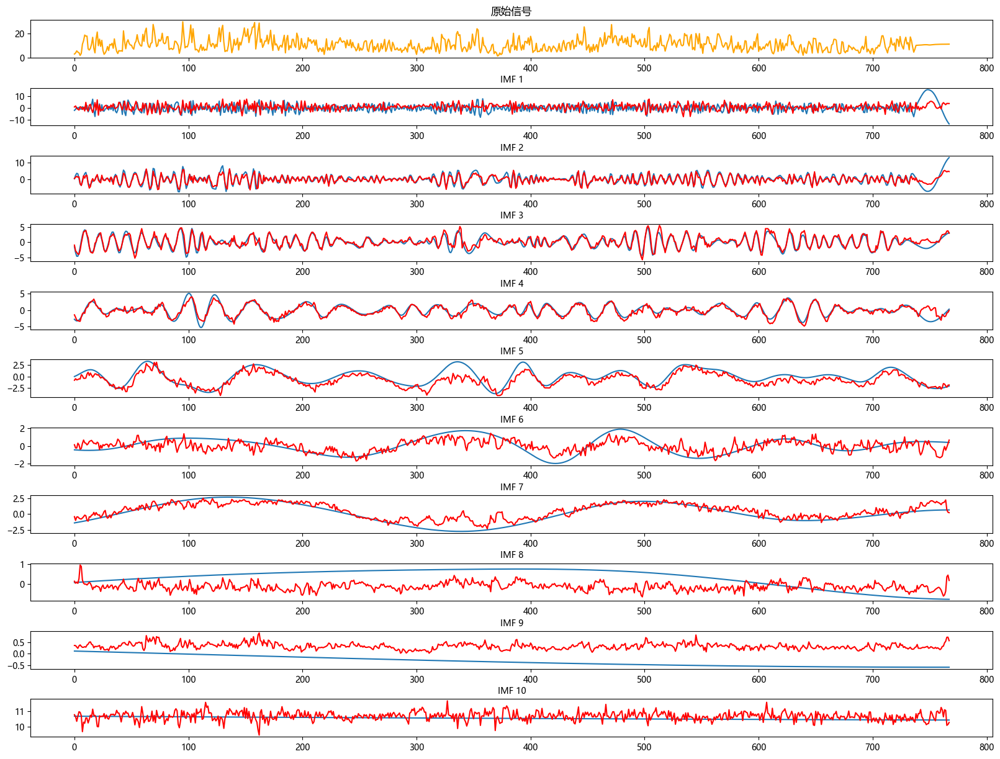
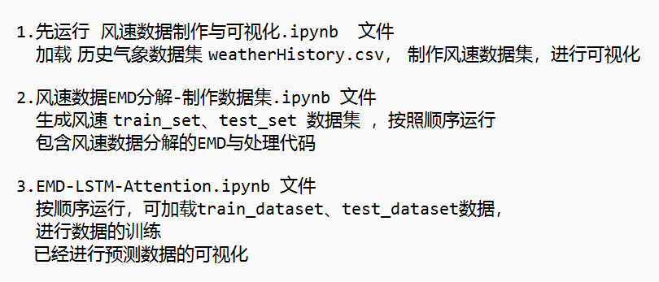
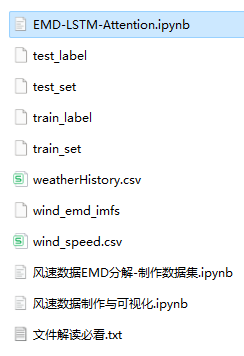

# (Single Step) Wind Speed Forecasting: Predictive Model Based on EMD-LSTM

Multi-feature variables include the following:
Including wind speed data, as well as the EMD-decomposed wind speed dataset and label set that has been generated and prepared. The corresponding codes can be run, and there are also examples of EMD decomposition.
Includes the code for data EMD preprocessing and the EMD-LSTM prediction code.
Environment: Python 3.9
\n        \n      (Platform displays fewer uploaded files than the ones in the image: Platform has a limit on the number of files it can upload. According to the file explanation, run the code as explained, and data can be generated based on the uploaded code)
\n        \n  
\n        \n  

## Images

<!-- PAYMENT_BLOCK -->

## Get this dataset

- Payment link (Stripe): [Buy now](https://buy.stripe.com/3cs8yP7sY87d0vu9AB)
- Payment QR code: 

<!-- /PAYMENT_BLOCK -->
